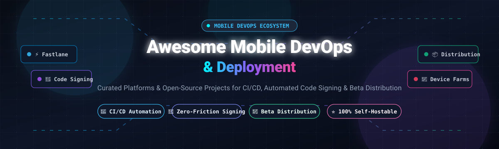

# 🚀 Awesome Mobile DevOps &amp; Deployment

  <strong>A curated ecosystem of SaaS platforms and open-source tools for Mobile CI/CD, automated code signing, self-hosted beta distribution, real-device testing, and zero-downtime app release engineering.</strong>

  <a href="#-sector-overview--market-dynamics">Sector Overview</a> •
  <a href="#-saas--hosted-platforms">SaaS Platforms</a> •
  <a href="#-open-source-github-projects">Open-Source Projects</a> •
  <a href="#-migration--ecosystem-alerts">Ecosystem Alerts</a> •
  <a href="#-how-to-contribute">Contributing</a> •
  <a href="#-star-history">Star History</a> •
  <a href="#-support--sponsorship">Support</a>

---

## 📌 Introduction &amp; Core Philosophy

In mobile engineering, shipping an app is profoundly different from shipping web services. Mobile delivery requires compiling on clean, authenticated operating systems (macOS for Xcode/iOS and Linux/macOS for Android), managing cryptographic certificates and provisioning profiles that regularly expire, orchestrating beta build distribution across fragmented device UDIDs, and conducting automated tests against real mobile hardware.

This repository tracks the leading **SaaS platforms** and **battle-tested open-source projects** that automate this entire critical path — transforming release operations from a stressful manual chore into a predictable, transparent, and reproducible pipeline.

---

## 🌐 Sector Overview &amp; Market Dynamics

- **Estimated Market Size**: The global Mobile DevOps, Continuous Integration, and App Deployment market is estimated at **$12.5 Billion to $15.8 Billion (2025–2026)** and is projected to surpass **$30 Billion by 2030**, advancing at a CAGR of ~20.5% driven by cross-platform frameworks (Flutter, React Native), automated device testing farms, and rigorous app store compliance demands.
- **Market Structure &amp; Fragmentation**: The sector exhibits a **moderately fragmented, dual-layer barbell dynamic**. At the gateway and OS tier, **Apple (TestFlight / App Store)** and **Google (Firebase / Play Console)** maintain concentrated gatekeeper control over app store ingestion and signing certificates. However, the build execution, orchestration, and automated testing tier is **moderately fragmented** between hyperscaler generalist CIs (GitHub Actions, CircleCI), dedicated mobile-first cloud CI platforms (Bitrise, Codemagic, Appcircle), and rapidly expanding self-hosted open-source software (Fastlane, Maestro, OpenSTF, Tuist).

---

## ☁️ SaaS &amp; Hosted Platforms

The table below features notable commercial and hosted platforms for Mobile CI/CD, device testing, and beta distribution, sorted in descending order by company scale (market valuation / parent market cap).

| Platform / Vendor | Company Size / Valuation | Starting Tier Pricing | Free Tier Limits | Key Highlights &amp; Best For |
| :--- | :--- | :--- | :--- | :--- |
| [**Apple TestFlight**](https://developer.apple.com/testflight/) | **~$3.40 Trillion** (Market Cap) | **$99/year** (~$8.25/mo via Apple Developer Program) | **No standalone free tier**; $99/yr program includes TestFlight for up to 100 internal testers (30 devices each) &amp; 10,000 external testers per build (90-day retention) | **Best for native iOS teams** requiring official Apple ecosystem compliance, internal testing, and public external link distribution without UDID management. |
| [**Microsoft GitHub Actions**](https://github.com/features/actions) | **~$3.10 Trillion** (Market Cap) | **$4/user/month** (Team tier) + runner compute ($0.008/min Linux, $0.064/min macOS M1 runner) | **2,000 free minutes/month** for private repos (unlimited minutes on public repos), 500 MB GitHub Packages storage, 1 concurrent macOS runner | **Best for repositories already hosted on GitHub** wanting native repository automation, unified secrets, and CI workflows without external vendors. |
| [**Google Firebase App Distribution**](https://firebase.google.com/products/app-distribution) | **~$2.10 Trillion** (Market Cap) | **$0 / Free of charge** (Included at $0 extra cost in Spark &amp; Blaze plans) | **Free forever**; up to 10,000 testers per project, 200 testers per group, 1,000 releases per app, unlimited downloads/month | **Best for cross-platform teams** seeking zero-cost iOS/Android beta distribution with direct Fastlane plugin and Firebase SDK integration. |
| [**BrowserStack App Live &amp; Automate**](https://www.browserstack.com/app-live) | **~$4.00 Billion** (Valuation) | **$29/user/month** (App Live billed annually at $348/yr) or $39/mo monthly | **14-day free trial**; includes 1-minute live interactive session on real physical devices and 100 automated mobile test minutes | **Best for QA &amp; release teams** requiring instant access to thousands of real physical Android and iOS devices without maintaining on-prem hardware. |
| [**CircleCI**](https://circleci.com/) | **~$1.70 Billion** (Valuation) | **$15/month** (Standard plan: 3 users, 6,000 credits/mo; macOS compute at 50 credits/min) | **6,000 build credits/month free forever** (~30,000 Linux min or ~120 standard macOS min), up to 30 concurrent jobs, 1 user limit | **Best for multi-stack engineering teams** wanting fast pipeline parallelism, reusable Orbs, and robust enterprise macOS executors. |
| [**Bitrise**](https://bitrise.io/) | **~$600 Million** (Valuation) | **$89/month** (Starter tier: 1,000 build credits/mo, 1 concurrency, 45-min build timeout) | **Free forever Hobby plan**: 300 credits/month, 1 concurrency, 30-min build timeout limit, 1 team seat, Apple Silicon runner access | **Best for mobile-first organizations** requiring 400+ turnkey mobile integrations, visual workflow builders, and automated code signing management. |
| [**Kobiton**](https://kobiton.com/) | **~$100 Million** (Valuation) | **$75/month** (Startup tier billed annually, or $99/mo monthly; 500 real device minutes/mo) | **14-day free trial**; 120 testing minutes on real iOS and Android devices with full gesture support and crash log capture | **Best for mobile teams needing real-device validation**, scriptless test automation, and hybrid cloud/on-premise device infrastructure. |
| [**Codemagic**](https://codemagic.io/) | **~$35 Million** (Valuation) | **$49/month** (Pro plan: 3 concurrent builds, 500 free M1 minutes/mo, extra min at $0.038–$0.075/min) | **500 build minutes/month free forever** on Apple Silicon M1 (or 500 min on 2-core Linux VM), 1 concurrency, 120-min build timeout, unlimited seats | **Best for Flutter, React Native, and native teams** seeking native Apple Silicon speed, zero-configuration signing, and hosted CodePush OTA updates. |
| [**Appcircle**](https://appcircle.io/) | **~$25 Million** (Valuation) | **$49/month** (Developer plan: 1 concurrent build, 60-min build timeout, unlimited repo connects) | **Free forever plan**: 20 builds/month, 1 concurrent build, 30-min max build timeout, 1 team member seat, 500 MB artifact storage | **Best for enterprise mobile pipelines** demanding centralized signing identity vaults, automated store submissions, and white-label enterprise distribution portals. |

---

## 🛠️ Open-Source GitHub Projects

Curated list of production-grade open-source tools for mobile automation, build orchestration, device farms, signing, and self-hosted distribution. Sorted in descending order by GitHub stargazers.

| Project | GitHub_Stars | Focus Area | Description &amp; Capabilities |
| :--- | :--- | :--- | :--- |
| [**fastlane/fastlane**](https://github.com/fastlane/fastlane) |  | Build &amp; Release Automation | The industry standard for iOS and Android deployment. Automates screenshots (`snapshot`), beta distribution (`pilot`), App Store metadata (`deliver`), and encrypted Git-based code signing (`match`). |
| [**appium/appium**](https://github.com/appium/appium) |  | Cross-Platform Testing | Open-source, cross-platform test automation framework for native, hybrid, and mobile web applications using the W3C WebDriver protocol across iOS, Android, and Windows. |
| [**mobile-dev-inc/Maestro**](https://github.com/mobile-dev-inc/maestro) |  | UI &amp; E2E Testing | Painless, declarative mobile UI automation built from the ground up for iOS and Android. Replaces flaky E2E tests with simple, human-readable YAML flows. |
| [**openstf/stf**](https://github.com/openstf/stf) |  | Device Farm &amp; Remote Access | Smartphone Test Farm: web application for debugging and controlling real Android devices remotely in browser with real-time screen streaming and ADB access. |
| [**wix/Detox**](https://github.com/wix/Detox) |  | Gray-Box Automation | Gray-box end-to-end testing and automation library for mobile apps. Synchronizes directly with app execution to eradicate test flakiness in React Native and native codebases. |
| [**tuist/tuist**](https://github.com/tuist/tuist) |  | Xcode Build Tooling | Command-line tool that leverages project generation and selective compilation to scale Xcode development and optimize CI build execution times. |
| [**google/EarlGrey**](https://github.com/google/EarlGrey) |  | iOS UI Automation | Google's native iOS UI automation test framework with built-in synchronization that automatically waits for UI events, network requests, and animations to settle. |
| [**danger/danger**](https://github.com/danger/danger) |  | Pull Request Etiquette &amp; CI | Automated PR code review tool used extensively in mobile pipelines to enforce changelog entries, verify App Store metadata, inspect binary sizes, and lint diffs. |
| [**facebook/idb**](https://github.com/facebook/idb) |  | iOS Simulator &amp; Device Bridge | iOS Development Bridge: command-line interface created by Meta for managing, querying, and automating iOS Simulators and physical devices over a network socket. |
| [**DeviceFarmer/stf**](https://github.com/DeviceFarmer/stf) |  | Device Farm Management | The actively maintained community continuation of OpenSTF, adding support for modern Android versions (Android 11–15+), improved WebSockets, and updated node runtimes. |
| [**SonicCloudOrg/sonic-server**](https://github.com/SonicCloudOrg/sonic-server) |  | Cloud Testing Platform | Next-generation distributed mobile device farm and cloud testing platform supporting Android, iOS, Windows, and macOS test orchestration. |
| [**cpisciotta/xcbeautify**](https://github.com/cpisciotta/xcbeautify) |  | Build Log Formatter | Fast, zero-dependency Xcode build output formatter written in Swift. Transforms noisy `xcodebuild` logs into clean, readable CI output and annotations. |
| [**thyrlian/AndroidSDK**](https://github.com/thyrlian/AndroidSDK) |  | Containerized Build Environments | Complete Docker image containing Android SDK, Command-line Tools, NDK, and emulator environments optimized for running Android CI/CD pipelines anywhere. |
| [**tryzealot/zealot**](https://github.com/tryzealot/zealot) |  | Self-Hosted Beta Distribution | Over-the-air beta deployment platform for iOS, Android, macOS, Linux, and Windows apps. Offers one-click Apple test device UDID registration, Fastlane plugins, and custom webhooks. |
| [**expo/orbit**](https://github.com/expo/orbit) |  | Desktop Build Launcher | macOS and Windows menu bar application designed by Expo to accelerate testing by launching Android emulators, iOS simulators, and installing build artifacts in one click. |
| [**Apple-Actions/import-codesign-certs**](https://github.com/Apple-Actions/import-codesign-certs) |  | GitHub Actions Signing | GitHub Action for securely importing Apple code signing certificates and provisioning profiles into ephemeral macOS runner keychains during CI runs. |
| [**oore-ci/oore.build**](https://github.com/oore-ci/oore.build) |  | Self-Hosted Mobile CI | Self-hosted, Flutter-first mobile CI and internal app distribution daemon (`oored`) and CLI (`oore`) supporting multi-Mac distributed runner roles. |

---

## ⚠️ Migration &amp; Ecosystem Alerts

> [!WARNING]
> **Microsoft Visual Studio App Center Retirement**: App Center was formally **retired on March 31, 2025**. All cloud build, device test cloud, and beta distribution services have ceased operations. Teams relying on App Center must migrate to alternative platforms such as Bitrise, Codemagic, GitHub Actions, or self-hosted Zealot.

> [!CAUTION]
> **Ionic Appflow End-Of-Life**: Ionic has stopped new sales of Appflow, and existing accounts will **lose platform access on December 31, 2027**. Migrate active cross-platform pipelines before the sunset window closes.

> [!IMPORTANT]
> **iOS Code Signing Fragility**: Cryptographic code signing remains the leading cause of broken mobile CI pipelines. Ensure your workflows employ automated profile synchronization via tools like `fastlane match` (Git-backed encrypted certificates) or managed cloud keystore secrets rather than manual local certificates.

---

## 🤝 How to Contribute

Contributions are warmly welcomed! Help expand this ecosystem map by suggesting tools, updates, or corrections:

1. 🍴 **Fork the repository** on GitHub.
2. 🌿 **Create a dedicated branch**: `git checkout -b feature/new-tool-entry`.
3. 📝 **Add your entry** following the table format, adhering to verified starting tier pricing and specific free-tier limits.
4. 📬 **Submit a Pull Request** with a concise description of the tool's relevance to mobile deployment.

Please keep entries factual, link to official sites or repositories, and verify license terms before submitting.

---

## 📈 Star History

---

## 💖 Support &amp; Sponsorship

Thank you for exploring **Awesome-Mobile-Devops-Deployment**! Curating, auditing, and maintaining accurate pricing, free-tier limitations, and open-source tooling across the mobile landscape requires continuous effort.

If you find this resource valuable for your team, please consider supporting the project:

- ⭐ **Star this repository** to improve visibility across the GitHub community.
- 🔀 **Fork and share** with colleagues and mobile engineering communities.
- ☕ **Buy a coffee or become a sponsor**: Support ongoing open-source curation on the [**GitHub Sponsors Dashboard**](https://github.com/sponsors/ishandutta2077).

---

  Maintained with ❤️ by <a href="https://github.com/ishandutta2007">Ishan Dutta</a> and community contributors. Licensed under the MIT License.

